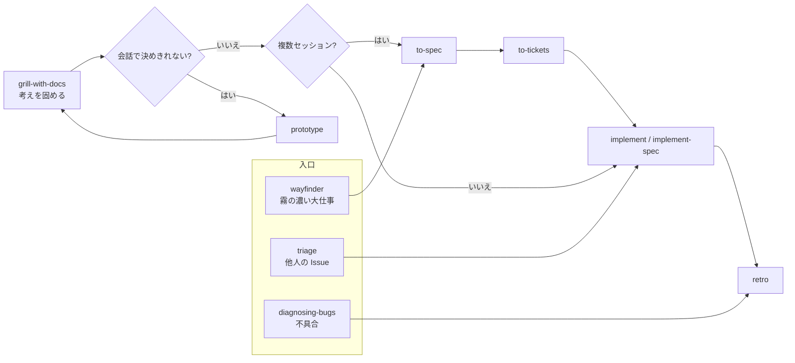

# mattpocock-skills ガイド — 全 skill の日本語解説（2026-11）

> 出典（一次情報）:
> - [mattpocock/skills (github.com)](https://github.com/mattpocock/skills/tree/49dd158d1076134a641b33efb035946536778336) — skill 集の本体。v1.3.1（commit 49dd158）
> - [plugin.json (github.com/mattpocock/skills)](https://github.com/mattpocock/skills/blob/49dd158d1076134a641b33efb035946536778336/.claude-plugin/plugin.json) — plugin に登録されている 27 の skill
> - [ask-matt/SKILL.md (github.com/mattpocock/skills)](https://github.com/mattpocock/skills/blob/49dd158d1076134a641b33efb035946536778336/skills/engineering/ask-matt/SKILL.md) — skill の地図（main flow と on-ramp）
>
> 最終更新: 2026-11-15（mattpocock-skills v1.3.1、commit 49dd158 で確認。各 skill の SKILL.md と照合）

Matt Pocock の skill 集 [mattpocock/skills](https://github.com/mattpocock/skills) を Claude Code の plugin（`mattpocock-skills@claude-plugins-official`）として使うためのガイドである。plugin に登録されている 27 の skill を 1 本ずつ日本語で解説し、実際の進め方は [手順書](playbook.md) にまとめた。

- 本ガイドは要約である。食い違ったら各 skill の `SKILL.md` が正しい
- plugin を更新すると、skill の顔ぶれや手順が変わることがある。本ガイドは v1.3.1 の時点の内容である
- 作者の開発環境そのものについては [Matt Pocock の AI コーディング環境](../matt-pocock-dev-environment.md) を参照

---

## 1. TL;DR

- 迷ったら `/mattpocock-skills:ask-matt` に状況を書く。どの skill を使えばよいかを案内する skill で、自分では何も作らない
- 進め方（どの順で、どの skill を打つか）と git / GitHub の権限の扱いは [手順書](playbook.md) にある
- 16 の skill は利用者だけが起動でき、11 の skill は Claude も自分で起動できる（§3 の「起動」列）

## 2. 全体像

- `implement` は内部で `tdd`（red → green を 1 切れずつ）を進め、最後に `code-review`（Standards と Spec の 2 軸）を走らせる
- `domain-modeling`（用語集と ADR）と `codebase-design`（deep module の語彙）は、他の skill の下で働く語彙の層である

## 3. skill の一覧（plugin に登録されている 27 本）

起動: 「ユーザー」は利用者だけが起動できる（`disable-model-invocation: true`）。「両方」は Claude も起動できる。

### 3.1 engineering（20 本）

| skill | 起動 | 何をするか | 外部への書き込み |
|---|---|---|---|
| [ask-matt](skills/ask-matt.md) | ユーザー | どの skill・流れを使うかを案内する | なし |
| [grill-with-docs](skills/grill-with-docs.md) | ユーザー | 質問攻めで考えを固め、用語と決定を記録に残す | `GLOSSARY.md`・`docs/adr/` |
| [domain-modeling](skills/domain-modeling.md) | 両方 | 用語集と ADR でドメインの言葉を磨く | `GLOSSARY.md`・`docs/adr/` |
| [codebase-design](skills/codebase-design.md) | 両方 | deep module の設計語彙（module・interface・seam など） | なし |
| [prototype](skills/prototype.md) | 両方 | 設計の問いに答える捨てるつもりのコードを作る | 捨てるブランチへの commit・Issue へのコメント |
| [research](skills/research.md) | 両方 | background agent が一次情報を調べ、出典つきの Markdown を残す | リポジトリ内の Markdown |
| [to-spec](skills/to-spec.md) | ユーザー | 会話を spec にまとめて tracker に起票する | Issue・ラベル |
| [to-tickets](skills/to-tickets.md) | ユーザー | spec を縦切りの ticket に分け、ブロック関係を付けて起票する | Issue・ラベル |
| [implement](skills/implement.md) | ユーザー | spec か ticket を実装する（tdd → code-review → commit） | commit |
| [implement-spec](skills/implement-spec.md) | ユーザー | ticket を subagent に並列で実装させ、統合ブランチにまとめる | ブランチ・worktree・マージ・draft PR |
| [tdd](skills/tdd.md) | 両方 | red → green のループでテスト駆動に作る（refactor はループに含めず、レビューの段で扱う） | なし（コードとテストを書く） |
| [code-review](skills/code-review.md) | 両方 | 基準点からの差分を Standards と Spec の 2 軸でレビューする | なし |
| [pr](skills/pr.md) | 両方 | PR 本文の形（最小の図・前後の証拠・one-way / two-way door）を示す | なし |
| [retro](skills/retro.md) | ユーザー | セッションを振り返り、agent の環境の改善案を出す | なし（提案だけ） |
| [diagnosing-bugs](skills/diagnosing-bugs.md) | 両方 | 必ず赤くなる再現を作ってから、不具合を直す | なし（修正と回帰テストを書く） |
| [triage](skills/triage.md) | ユーザー | 他人からの Issue を triage の状態に沿って進める | Issue / PR のコメント・ラベル・close、`.out-of-scope/`・`GLOSSARY.md` / ADR |
| [wayfinder](skills/wayfinder.md) | ユーザー | 大仕事を「決めることの地図」にして 1 件ずつ解く | Issue・ラベル・assign・close、`research/*` ブランチの push |
| [improve-codebase-architecture](skills/improve-codebase-architecture.md) | ユーザー | deep にできる箇所を探し、HTML のレポートにする | `$TMPDIR` の HTML・`GLOSSARY.md` |
| [wizard](skills/wizard.md) | 両方 | 人間にしかできない手順を対話式の bash スクリプトにする | スクリプト（望んだときだけ commit） |
| [setup-matt-pocock-skills](skills/setup-matt-pocock-skills.md) | ユーザー | tracker・ラベル・用語集の置き場所を設定する | `docs/agents/`・CLAUDE.md / AGENTS.md・ラベル |

### 3.2 productivity（7 本）

| skill | 起動 | 何をするか | 外部への書き込み |
|---|---|---|---|
| [grilling](skills/grilling.md) | 両方 | 質問攻めの本体（grill-me・grill-with-docs などが中で使う） | なし |
| [grill-me](skills/grill-me.md) | ユーザー | リポジトリの外で、記録を残さずに質問攻めにする | なし |
| [handoff](skills/handoff.md) | ユーザー | 会話を圧縮した引き継ぎ文書を書く | `$TMPDIR` のファイル |
| [teach](skills/teach.md) | ユーザー | 作業ディレクトリを教材の置き場にして、複数セッションで教える | `MISSION.md`・`lessons/` など |
| [to-questionnaire](skills/to-questionnaire.md) | ユーザー | 自分では答えられない判断を、他人向けの質問票にする | カレントディレクトリの Markdown |
| [wait-what](skills/wait-what.md) | ユーザー | 伝わらなかった直前の説明を言い直させる | なし |
| [writing-for-agents](skills/writing-for-agents.md) | 両方 | agent が読む文書（skill・CLAUDE.md など）の書き方 | なし |

## 4. plugin に登録されていない skill（参考）

リポジトリには、plugin に入っていない skill もある。`misc` は「plugin では推していない」もの、`in-progress` は試作中で plugin から外されているものである（各ディレクトリの README）。使うなら `npx skills@latest add mattpocock/skills --skill=<name>` で個別に入れる。本ガイドでは個別のページを作らない。

| skill | 分類 | 何をするか |
|---|---|---|
| git-guardrails-claude-code | misc | 危険な git コマンドを止める hook を設定する |
| migrate-to-shoehorn | misc | テストの `as` を shoehorn に移す |
| scaffold-exercises | misc | 演習用のディレクトリを作る |
| setup-pre-commit | misc | Husky と lint-staged の pre-commit を設定する |
| chief-of-staff | in-progress | subagent を指揮して長期の目標を進める |
| claude-handoff | in-progress | 新しい background agent に引き継ぐ |
| loop-me | in-progress | 作りたいワークフローの spec を問い詰める |
| setup-ts-deep-modules | in-progress | dependency-cruiser で deep module を強制する |
| writing-beats・writing-fragments・writing-shape | in-progress | 記事を書くための 3 段階（断片 → beat → 形） |

`deprecated` は空である。退役した skill は削除され、置き換え先は削除時の changeset に書かれる。

## 5. 各ページの構成

skill ごとのページは、どれも次の順に並ぶ。

1. TL;DR
2. 基本情報（カテゴリ・起動・呼び出し方・内部で呼ぶ skill・外部への書き込み）
3. いつ使うか・使わないか
4. 流れ
5. 書き込むもの・副作用（`SKILL.md` の行番号つき）
6. 前後の skill
7. 注意点

## 出典

| 情報源 | URL |
|---|---|
| mattpocock/skills（v1.3.1） | https://github.com/mattpocock/skills/tree/49dd158d1076134a641b33efb035946536778336 （2026-11-15 確認、plugin キャッシュの v1.3.1 で照合） |
| plugin.json | https://github.com/mattpocock/skills/blob/49dd158d1076134a641b33efb035946536778336/.claude-plugin/plugin.json （2026-11-15 確認） |
| misc / in-progress の README | https://github.com/mattpocock/skills/tree/49dd158d1076134a641b33efb035946536778336/skills （2026-11-15 確認） |
| Skills（Claude Code docs） | https://code.claude.com/docs/en/skills （2026-11-15 確認） |

- 関連: [手順書](playbook.md) / [Matt Pocock の AI コーディング環境](../matt-pocock-dev-environment.md) / [Skills ガイド](../skills.md) / [Plugins ガイド](../plugins.md)
