# プログラミング言語の人気トレンドの調べ方

> 出典（一次情報）:
> - [Languish](https://tjpalmer.github.io/languish/) / [tjpalmer/languish](https://github.com/tjpalmer/languish) — GitHub + Stack Overflow の合成スコア
> - [Languish（Innovation Graph 版の fork）](https://thanks2music.github.io/languish/) / [thanks2music/languish](https://github.com/thanks2music/languish) — GitHub Innovation Graph の言語別 push 人数
> - [GitHub Innovation Graph](https://github.com/github/innovationgraph) / [datasheet](https://github.com/github/innovationgraph/blob/main/docs/datasheet.md) — fork 版のデータ源（CC0-1.0）
> - [GitHut 2.0](https://madnight.github.io/githut/) / [madnight/githut](https://github.com/madnight/githut) — GitHub Archive の言語別集計
> - [Google Trends](https://trends.google.com/trends/) — 検索数の比較
> - [TIOBE Index](https://www.tiobe.com/tiobe-index/) — 2026 年 10 月版と、同月の算出方法の変更
> - [PYPL PopularitY of Programming Language](https://pypl.github.io/PYPL.html) — 2026 年 11 月版
> - [The RedMonk Programming Language Rankings: January 2026](https://redmonk.com/sogrady/2026/04/14/language-rankings-1-26/) — 2026-04-14 公開
> - [The Top Programming Languages 2025 (IEEE Spectrum)](https://spectrum.ieee.org/top-programming-languages-2025) — 2025-09-23 公開
> - [Octoverse: Commits, pushes, reach new highs in 2026 as developers build with agents (GitHub Blog)](https://github.blog/news-insights/octoverse/octoverse-commits-pushes-reach-new-highs-in-2026-as-developers-build-with-agents/) — 2026-10-28 公開
> - [Stack Overflow Developer Survey 2026 — Technology](https://survey.stackoverflow.co/2026/technology) / [The results of the 2026 Developer Survey are here!](https://stackoverflow.blog/2026/10/06/the-results-of-the-2026-developer-survey-are-here/) — 2026-10-06 公開
> - [The State of Developer Ecosystem in 2025 (JetBrains)](https://devecosystem-2025.jetbrains.com/tools-and-trends)
>
> 最終更新: 2026-11-05（Languish の Innovation Graph 版の fork を追加。それ以外の数値と順位、スクリーンショットは 2026-11-04 に各公式ページで確認したもの）

「世界でどのプログラミング言語が使われているか」の傾向を調べるためのサイトとレポートをまとめる。npm パッケージなら [npm trends](https://npmtrends.com/) でダウンロード数を比べられるが、**言語どうしを比べる共通の指標は存在しない**。そのため各サイトは、検索数・GitHub 上の活動量・開発者アンケートのいずれかを代わりの指標として使っている。どのサイトが何を測っているかを押さえてから読むことが重要である。

> 各スクリーンショットは、出典を示したうえでの引用として掲載している。著作権は各サイトの運営者に帰属する。撮影条件はいずれも 1440×900 の画面で、Cookie の同意バナーは「拒否」または「必須のみ」を選んで閉じ、ポップアップも閉じてから撮影した。

---

## 一覧

| サイト | 分類 | 何を測っているか | 更新頻度 | 確認した最新版（2026-11-04 時点） |
|---|---|---|---|---|
| [Languish](#languish) | npm trends に近いもの | GitHub + Stack Overflow | 不定期 | グラフのデータは 2025 年まで |
| [Languish（Innovation Graph 版の fork）](#languishinnovation-graph-版の-fork) | npm trends に近いもの | GitHub の言語別 push 人数（GitHub 公式） | 毎月確認し、四半期ごとに更新 | 2026 年第 2 四半期 |
| [GitHut 2.0](#githut-20) | npm trends に近いもの | GitHub の PR・push・star・issue 数 | 更新停止 | 2024 年第 1 四半期 |
| [Google Trends](#google-trends) | npm trends に近いもの | Google の検索数 | ほぼリアルタイム | — |
| [TIOBE Index](#tiobe-index) | 定番のランキング | 検索エンジンのヒット件数 | 毎月 | 2026 年 10 月版（1 位 Python） |
| [PYPL](#pypl) | 定番のランキング | Google での「◯◯ tutorial」の検索数 | 毎月 | 2026 年 11 月版（1 位 Python） |
| [RedMonk](#redmonk) | 定番のランキング | GitHub のプロジェクト数 + Stack Overflow のタグ数 | 2025 年以降は年 1 回 | 2026 年 1 月版（1 位 JavaScript） |
| [IEEE Spectrum](#ieee-spectrum) | 定番のランキング | 複数の指標を合成 | 年 1 回 | 2025 年版（1 位 Python） |
| [GitHub Octoverse](#github-octoverse) | 実際の利用状況に近いデータ | GitHub の月ごとのコントリビューター数 | 年 1 回 | 2026 年版（1 位 TypeScript） |
| [Stack Overflow Developer Survey](#stack-overflow-developer-survey) | 実際の利用状況に近いデータ | 開発者アンケート（自己申告） | 年 1 回 | 2026 年版（1 位 JavaScript） |
| [JetBrains State of Developer Ecosystem](#jetbrains-state-of-developer-ecosystem) | 実際の利用状況に近いデータ | 開発者アンケート（自己申告） | 年 1 回 | 2025 年版（JavaScript 61%） |

分類の意味は次のとおり。

- **npm trends に近いもの**: 自分で言語を選び、時系列のグラフで比べられる
- **定番のランキング**: 毎月または毎年、順位表として発表される
- **実際の利用状況に近いデータ**: GitHub の活動実績や大規模アンケートに基づく年次レポート

---

## Languish

GitHub と Stack Overflow のデータを合成したスコアで、言語の推移を折れ線グラフで比べられるサイト。使い勝手は最も npm trends に近い。右の一覧から言語を選んでグラフを重ねられ、表示した状態は URL として保存できる（右上のリンクアイコン）。累計ではなく、その時期の活動量を見る設計になっている。

注意点として、撮影時点のグラフのデータは 2025 年までで止まっている。リポジトリへの最終 push は 2026-04-06 である（いずれも 2026-11-04 時点）。

https://tjpalmer.github.io/languish/

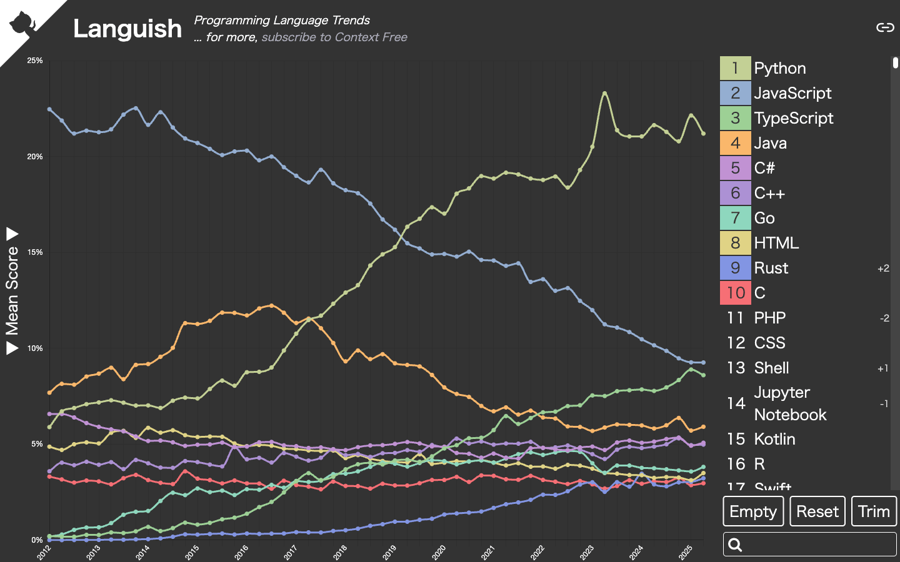

> 出典: [Languish](https://tjpalmer.github.io/languish/)（2026-11-04 撮影、既定表示）

## Languish（Innovation Graph 版の fork）

本家 Languish の更新が止まっているため、本リポジトリの作者が fork し、データ源を GitHub 公式の [Innovation Graph](https://github.com/github/innovationgraph)（CC0-1.0）に置き換えたもの。画面と操作（言語の選択・検索・permalink・対数軸）は本家と同じで、2020 年第 1 四半期から最新の四半期までを比べられる。

本家のデータ源をやめた理由は 2 つある。

- 本家の GitHub 側のデータ（star・PR・issue）は GH Archive から取っている。GH Archive は 2025 年 5 月下旬からイベントの取りこぼしが続き、2026 年は公開活動の一部しか記録できていない（[igrigorik/gharchive.org#310](https://github.com/igrigorik/gharchive.org/issues/310)・[#320](https://github.com/igrigorik/gharchive.org/issues/320)・[#326](https://github.com/igrigorik/gharchive.org/issues/326)）。
- Stack Overflow の新規質問は 2026 年には月 1,000 件前後まで減り、言語の利用を映さなくなった。

指標は「GitHub Pushers」の 1 つだけである。言語ごとの値は、その四半期に、その言語を含む公開リポジトリへ 1 回以上 push したユニーク開発者数で、国・地域（経済圏）の分を合計している。EU の行は加盟 27 か国の合計と同じ値なので、二重に数えないよう除いている。グラフには、その値が全言語の合計に占める割合（%）を描く。読むときの注意は次のとおり。

- **リポジトリに含まれるすべての言語に数える**。主要な言語だけではないので、HTML・CSS・Shell・Dockerfile のような補助的なファイルの言語が上位に来る。JavaScript が TypeScript より上になり、コントリビューター数で数える Octoverse（TypeScript が 1 位）とは順位が食い違う。
- **1 人の開発者が複数の言語に数えられる**ので、割合の分母は開発者の人数ではない。
- **データは 2020 年第 1 四半期から**で、それより前はない。
- 経済圏ごとに 100 人未満の値は公表されないため、小さい言語ほど少なめに出る。
- Innovation Graph は、四半期が終わってから約 4 か月後に公開される。fork 版は毎月 5 日に新しいデータを確認し、更新があれば反映用の PR を自動で作る。ヘッダーに「through 2026Q2」のように最新の四半期を表示し、9 か月以上古くなると「may be out of date」と警告を出す。

https://thanks2music.github.io/languish/

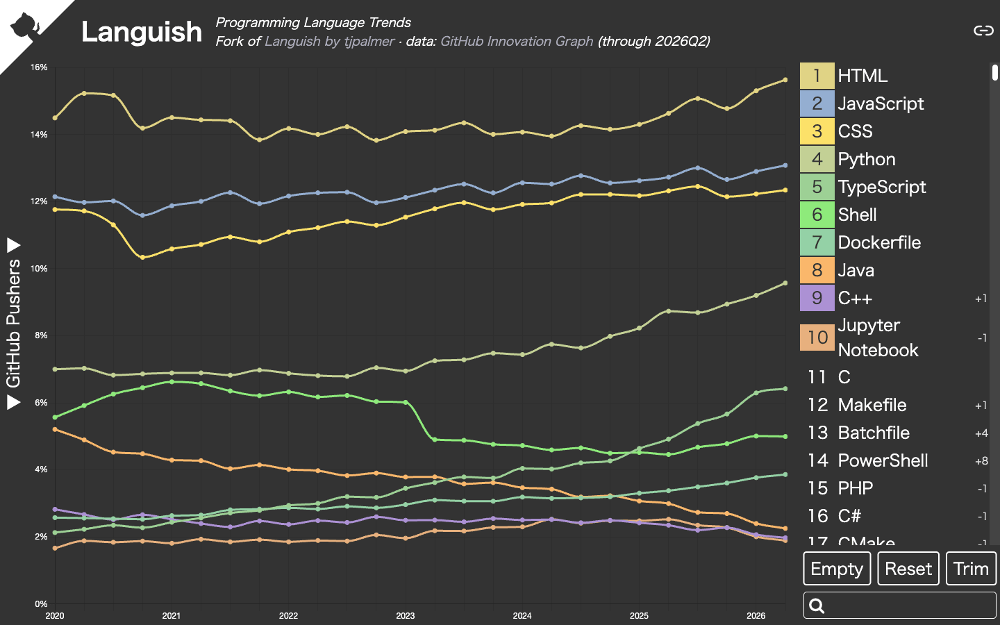

> 出典: [Languish（Innovation Graph 版の fork）](https://thanks2music.github.io/languish/)（2026-11-05 撮影、既定表示）

## GitHut 2.0

GitHub Archive のデータを Google BigQuery で集計し、言語ごとの PR 数・star 数・push 数・issue 数のシェアを四半期単位で見られるサイト。折れ線グラフは 2012 年第 2 四半期からの推移、下の表は選んだ四半期の上位 50 言語と前年比を示す。言語名をクリックするとグラフへの表示・非表示を切り替えられる。

注意点として、**データは 2024 年第 1 四半期で止まっている**（サイトを開くと自動的にこの四半期が選ばれる。2026-11-04 時点で、リポジトリへの最終 push は 2024-04-03）。2024 年以降の傾向を見る用途には使えない。

https://madnight.github.io/githut/

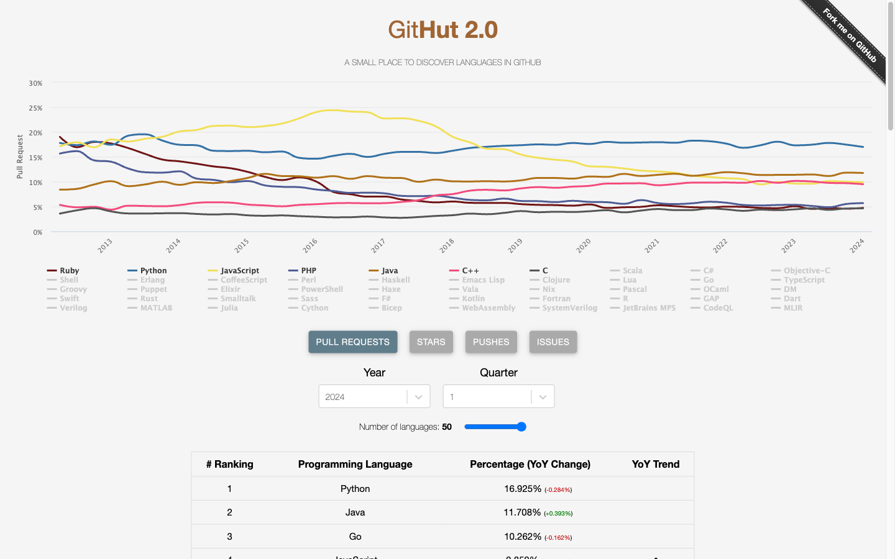

> 出典: [GitHut 2.0](https://madnight.github.io/githut/#/pull_requests/2024/1)（2026-11-04 撮影、既定表示 = Pull Requests / 2024 年第 1 四半期）

## Google Trends

Google の検索数の推移を最大 5 語まで比べられる。期間・地域・カテゴリを自由に変えられ、最新のデータまで見られる。

注意点として、「Go」「Rust」「Swift」「Java」のように一般の単語と重なる言語は、文字列のまま比べると無関係な検索まで数えてしまう。入力欄の候補から「Programming language」のトピックを選ぶ必要がある。なお PHP は、2026-11-04 時点では入力候補にトピックが出てこなかった。URL でトピック ID（`/m/060kv`）を直接指定すると「Programming language」として表示される。

数値は期間内の最大値を 100 とした相対値であり、検索の絶対数ではない。また検索数は「関心」の指標であって、実際の利用量を表すものではない。

https://trends.google.com/trends/explore?date=today%205-y&hl=en&q=%2Fm%2F05z1_,%2Fm%2F02p97,%2Fm%2F0n50hxv,%2Fm%2F060kv,%2Fm%2F07sbkfb

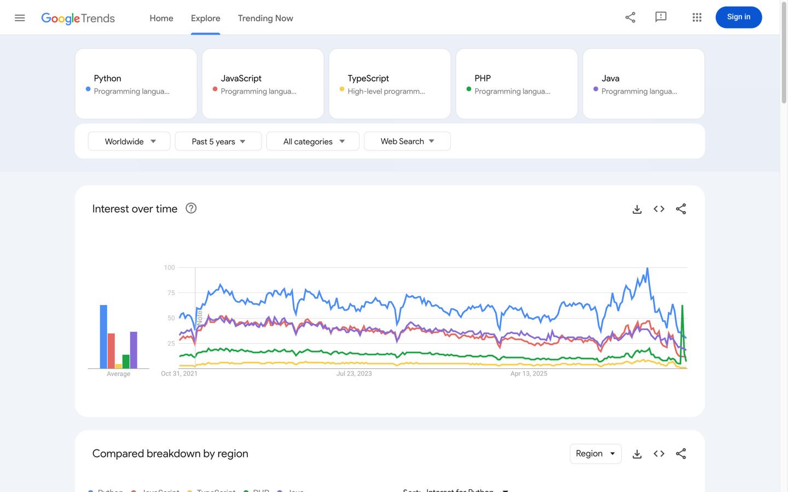

> 出典: [Google Trends](https://trends.google.com/trends/explore?date=today%205-y&hl=en&q=%2Fm%2F05z1_,%2Fm%2F02p97,%2Fm%2F0n50hxv,%2Fm%2F060kv,%2Fm%2F07sbkfb)（2026-11-04 撮影。5 語とも「プログラミング言語」のトピックで指定。Headless のブラウザでは 429 エラーで表示できないため、画面ありのブラウザで撮影した）

## TIOBE Index

オランダの TIOBE 社が毎月発表するランキング。検索エンジンで「`<言語名> programming`」を検索したときのヒット件数を元に算出する。最もよく知られた指標だが、「ヒット件数」は使われている量とも学ばれている量とも直接は対応しない。

2026 年 10 月版は 1 位 Python（19.23%）、2 位 C（11.33%）、3 位 C++（8.87%）、4 位 Java（8.41%）、5 位 C#（3.79%）。**この月から中国語の検索語（「`<言語名> 编程`」）も集計に加えた**ため、それ以前の月との比較には注意が要る。算出方法の変更はページ下部の「This Month's Changes in the Index」に毎月記載される。

https://www.tiobe.com/tiobe-index/

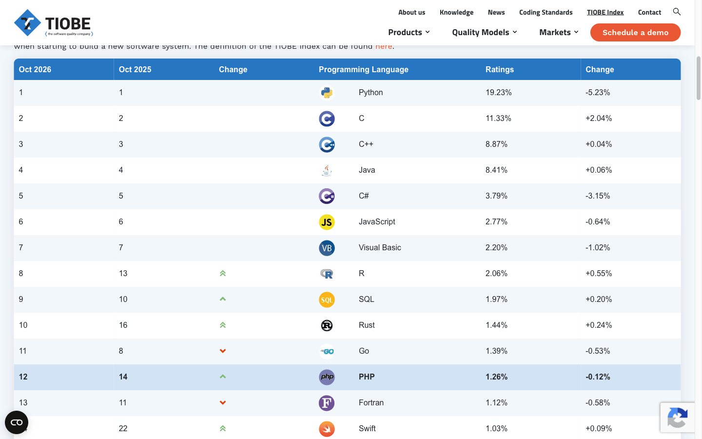

> 出典: [TIOBE Index](https://www.tiobe.com/tiobe-index/)（2026-11-04 撮影、2026 年 10 月版）

## PYPL

PYPL（PopularitY of Programming Language）は、Google で「`<言語名> tutorial`」が検索された回数を Google Trends から集計するランキングで、毎月更新される。チュートリアルの検索数を見ているため、「これから学ぼうとしている人の多さ」を表す先行指標と位置付けられている。

2026 年 11 月版（全世界）は 1 位 Python（52.04%）、2 位 Java（12.56%）、3 位 C/C++（8.49%）。TypeScript は 12 位（1.44%）と、ほかの指標より大幅に低い。

https://pypl.github.io/PYPL.html

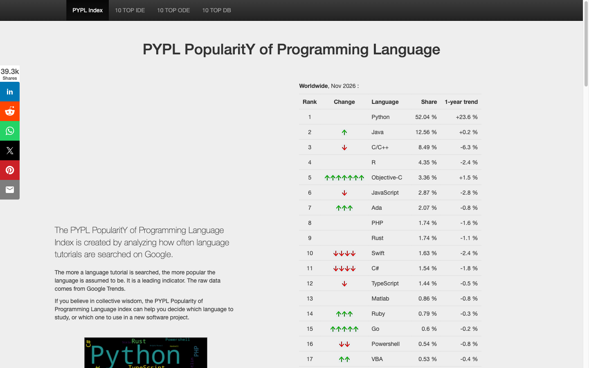

> 出典: [PYPL PopularitY of Programming Language](https://pypl.github.io/PYPL.html)（2026-11-04 撮影、2026 年 11 月版）

## RedMonk

アナリスト企業 RedMonk が発表するランキング。横軸を GitHub 上のプロジェクト数の順位、縦軸を Stack Overflow のタグ数の順位とした散布図で、両方で上位の言語ほど右上に来る。以前は 1 月版と 6 月版の年 2 回が基本だったが、2025 年以降は 1 月版だけの年 1 回になっている。

2026 年 1 月版（2026-04-14 公開）は 1 位 JavaScript、2 位 Python、3 位 Java、4 位 PHP・C#（同順位）、6 位 TypeScript。RedMonk 自身も、上位の顔ぶれがほとんど動かない一因は Stack Overflow の存在感が落ちていることにあると認めている。

https://redmonk.com/sogrady/2026/04/14/language-rankings-1-26/

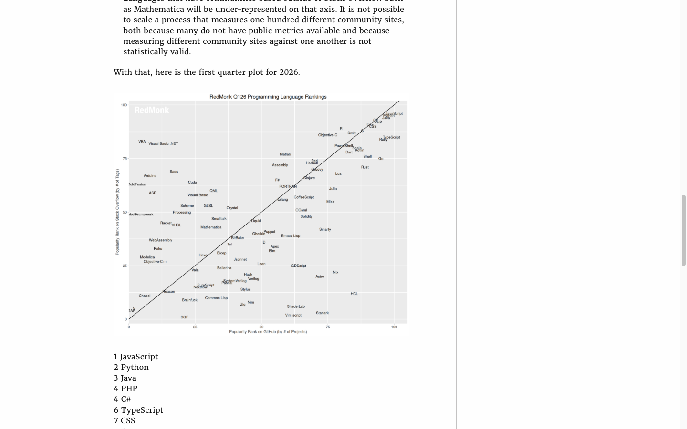

> 出典: [The RedMonk Programming Language Rankings: January 2026](https://redmonk.com/sogrady/2026/04/14/language-rankings-1-26/)（2026-11-04 撮影）

## IEEE Spectrum

IEEE（米国電気電子学会）の技術誌 IEEE Spectrum が毎年発表するランキング（Top Programming Languages）。Google の検索数、Stack Exchange の質問数、研究論文での言及、GitHub の活動、求人など複数の指標を合成する。画面上のボタンで、IEEE 会員の関心で重み付けした「Spectrum」、勢いを見る「Trending」、求人だけを見る「Jobs」の 3 種類を切り替えられる。

2026-11-04 時点の最新は 2025 年版（2025-09-23 公開）で、2026 年版はまだ出ていない。2025 年版の「Spectrum」は 1 位 Python、2 位 Java、3 位 C++ で、JavaScript は前年の 3 位から 6 位に下がった。記事は副題を「Does AI mean the end for the Top Programming Languages?」とし、AI による開発の変化で人気の計測そのものが難しくなっていると論じている。

https://spectrum.ieee.org/top-programming-languages-2025

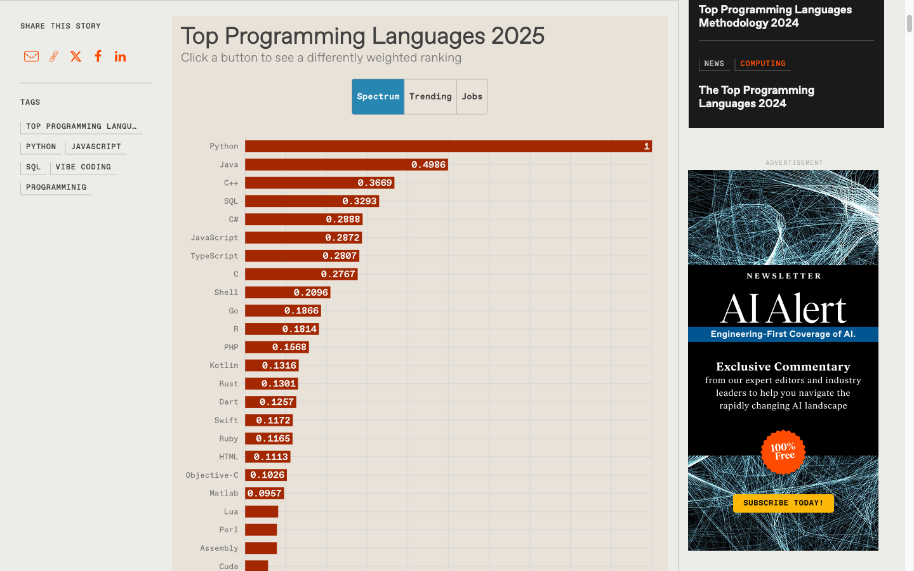

> 出典: [The Top Programming Languages 2025 (IEEE Spectrum)](https://spectrum.ieee.org/top-programming-languages-2025)（2026-11-04 撮影、「Spectrum」ランキング）

## GitHub Octoverse

GitHub が毎年発表する年次レポート。GitHub 上の実際の活動データを元にしており、言語については月ごとのコントリビューター数で順位を付ける。

2026 年版（2026-10-28 公開）では、1 位 TypeScript、2 位 Python、3 位 JavaScript で、前年に TypeScript が首位に立ったときの順序がそのまま続いた。2025 年 9 月から 2026 年 9 月までの 1 年間に、TypeScript は月間コントリビューターを 362 万人、Python は 323 万人、JavaScript は 182 万人増やしている。上位の言語のうち伸び率が最も大きかったのは Rust（1 年で倍増）。

2026 年版から集計の条件が変わった点に注意が要る。対象期間は 2025-10-01〜2026-09-30 で、特に断りのない指標は private リポジトリも含む。以前のレポートは public の活動だけを対象に、9 月 1 日〜8 月 31 日の期間で集計していた。2024 年と 2025 年の数値は新しい条件で計算し直されているため、過去のレポートに載っている数値とはそのまま比べられない。

https://github.blog/news-insights/octoverse/octoverse-commits-pushes-reach-new-highs-in-2026-as-developers-build-with-agents/

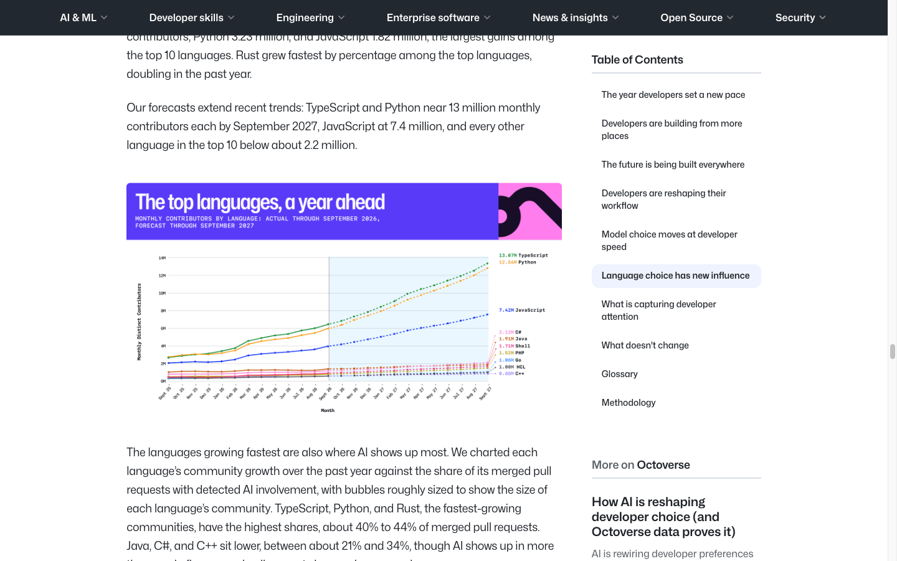

> 出典: [Octoverse: Commits, pushes, reach new highs in 2026 as developers build with agents](https://github.blog/news-insights/octoverse/octoverse-commits-pushes-reach-new-highs-in-2026-as-developers-build-with-agents/)（2026-11-04 撮影）

## Stack Overflow Developer Survey

Stack Overflow が毎年行う開発者アンケート。2026 年版（2026-10-06 公開）は 7 週間で 3 万人以上が回答した。

最も使われている言語は JavaScript（62.0%）で、12 年連続の 1 位。SQL（58.4%）、HTML/CSS（58.2%）、Python（58.0%）がほぼ並び、TypeScript は 6 位（43.8%）。自己申告のアンケートなので、Stack Overflow を使う層に回答者が偏る点は割り引いて読む必要がある。

https://survey.stackoverflow.co/2026/technology

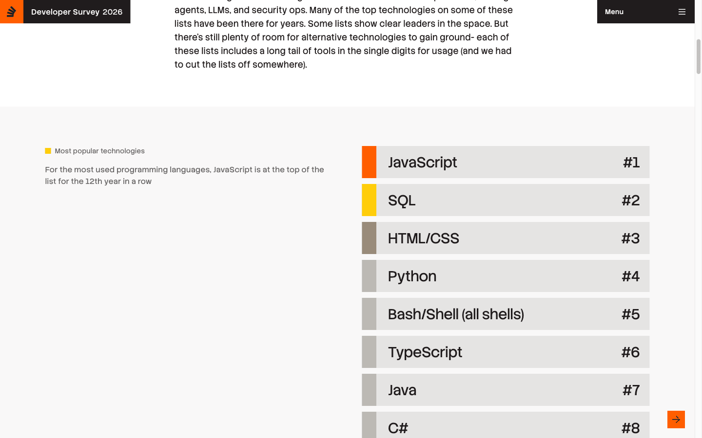

> 出典: [Stack Overflow Developer Survey 2026 — Technology](https://survey.stackoverflow.co/2026/technology)（2026-11-04 撮影）

## JetBrains State of Developer Ecosystem

JetBrains が毎年行う開発者アンケート。2026-11-04 時点の最新は 2025 年版で、回答者は 24,534 人。言語の利用率を 2017 年からの推移で見られるほか、伸びしろを測る独自の「Language Promise Index」（2025 年版は 1 位 TypeScript、2 位 Rust、3 位 Python）も載っている。

2025 年版の利用率は JavaScript 61%、Python 57%、HTML/CSS 52%、Java 49%、SQL 47%、TypeScript 42%。レポートは過去 5 年で最も大きく伸びた言語として TypeScript を挙げている。

https://devecosystem-2025.jetbrains.com/tools-and-trends

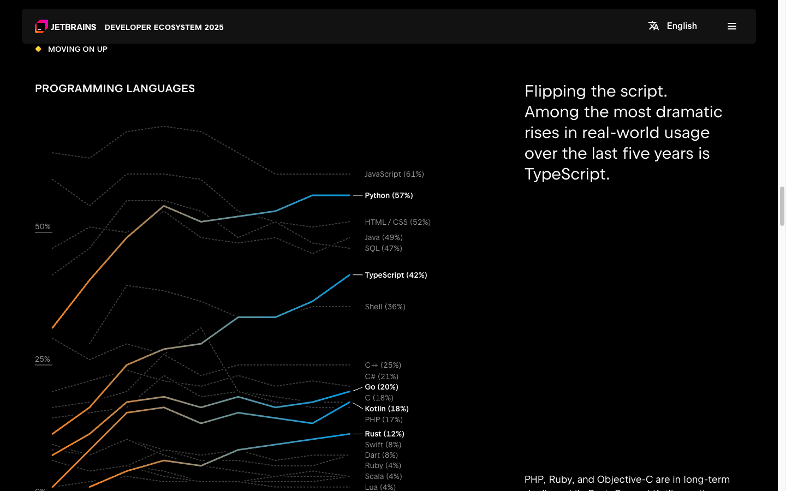

> 出典: [The State of Developer Ecosystem in 2025 — Tools and Trends](https://devecosystem-2025.jetbrains.com/tools-and-trends)（2026-11-04 撮影）

---

## 見るときの注意

- **「人気」の意味が指標ごとに違う。** 検索数（TIOBE・PYPL・Google Trends）は関心や学習の需要、GitHub の活動量（Octoverse・GitHut）は実際の利用、アンケート（Stack Overflow・JetBrains）は本人の申告を表す。同じ時期でも、TypeScript は Octoverse では 1 位、PYPL では 12 位というように大きく食い違う。
- **TIOBE は「世界で実際に使われている言語」の根拠としては弱い。** 最も有名だが、検索ヒット件数を元にしており、算出方法もたびたび変わる（2026 年 10 月にも中国語の検索語を追加した）。
- **AI の普及でデータがゆがんでいる。** Stack Overflow 2026 の調査では、64% が「簡単な質問では、AI があるので Stack Overflow を見る回数が減った」と答えている。Stack Overflow のデータを使う指標（RedMonk、Languish の一部）は傾向を拾いにくくなっており、RedMonk 自身もそれを認めている。GitHub 側でも、Octoverse 2026 によればマージされた PR のうち AI の関与が検出された割合は TypeScript・Python・Rust で約 40〜44% と高い。AI が書きやすい言語ほど数字の上で有利になっている可能性がある。
- **更新が止まったサイトがある。** GitHut 2.0 のデータは 2024 年第 1 四半期、本家 Languish のグラフは 2025 年までで止まっている。最新のデータで Languish を使うなら、Innovation Graph 版の fork を見る。

## 目的別の使い分け

| 目的 | 使うもの |
|---|---|
| 世界で実際に使われている言語の傾向を知りたい | 年に 1 回、**GitHub Octoverse**（実際の活動）と **Stack Overflow Developer Survey**（開発者の申告）を見比べる。JetBrains のレポートも補助になる |
| npm trends のように、言語を選んでグラフで比べたい | **Languish（Innovation Graph 版の fork）**。2020 年より前の推移は本家 **Languish**（2025 年まで）。最新の検索の動きまで見たいなら **Google Trends**（トピックを選ぶこと） |
| 関心・学習需要の変化を毎月追いたい | **TIOBE**・**PYPL**。実際の利用量の指標ではないことを前提に、補助として使う |
