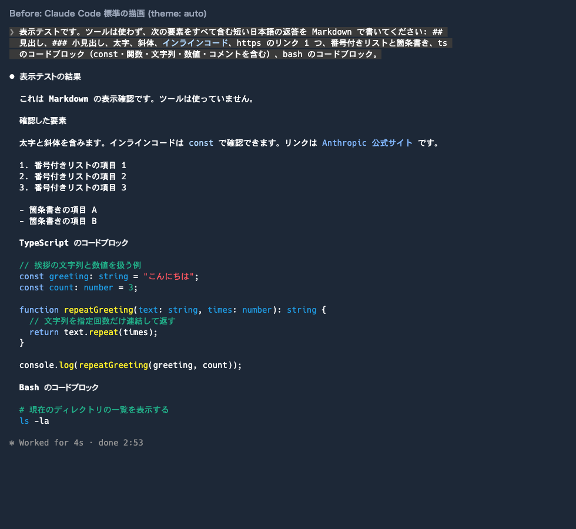
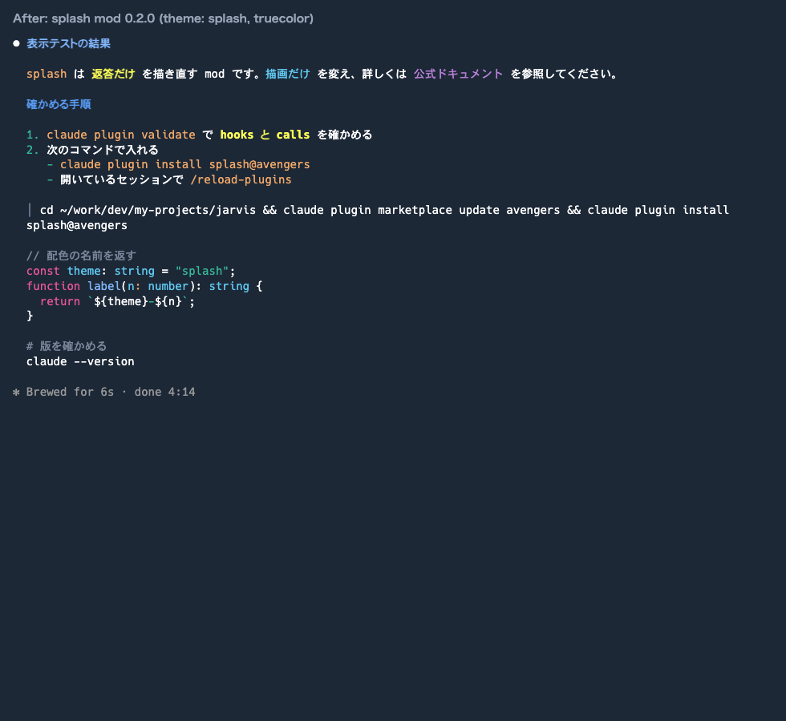

# 端末での Claude Code の表示を見やすくする（返答の色分け・truecolor・Zed）

> 出典:
> - [Terminal configuration — Create a custom theme](https://code.claude.com/docs/en/terminal-config#create-a-custom-theme)
> - [Settings reference — `theme`](https://code.claude.com/docs/en/settings-reference)
> - [Environment variables — `CLAUDE_CODE_TMUX_TRUECOLOR`](https://code.claude.com/docs/en/env-vars)
> - [Mods overview](https://code.claude.com/docs/en/plugins/mods/overview) / [Draw in the interface with a mod](https://code.claude.com/docs/en/plugins/mods/interface)
> - [anthropics/claude-code#93535](https://github.com/anthropics/claude-code/issues/93535)（Markdown 要素のテーマトークンの要望。2026-11-20 時点で Open）
> - [Zed Docs — Visual customization](https://zed.dev/docs/visual-customization) / [Themes](https://zed.dev/docs/themes)
> - 最終更新: 2026-11-20 JST（Claude Code v2.1.328、macOS、iTerm2 3.7.7 + tmux 3.8 で確認）

端末で Claude Code を使うと、返答の本文・見出し・太字がすべて白で描かれ、どこが見出しでどこが強調なのかを目で追いにくい。本書は、その原因と、公式の仕組みの範囲でできる改善をまとめる。結論は次のとおり。

1. **テーマでは解決しない**。Claude Code のテーマには、Markdown の要素ごとの色を決める項目が無い
2. **返答の色分けは mod で行う**。mod は返答（`AssistantMessage`）を描き直せる公式の仕組みで、自作の mod [`splash`](#3-splash-mod-で返答を色分けする) で見出し・太字・コードに色を付けた
3. **tmux の中では 24-bit カラーを通す設定が要る**。既定では 256 色に落とされ、mod の色が正しく出ない
4. **Zed のエージェントパネルには mod が効かない**。Zed 側のフォント・テーマの設定で調整する





> 2 枚は同じ依頼に対する別々の返答で、文面は少し違う。どちらも tmux の `capture-pane -e` で取った色を、iTerm2 の配色（背景 `#1d2837`）で HTML に描き直して撮った。

---

## 1. なぜ白一色になるのか

Claude Code は返答の Markdown を自前で描く。そのとき、本文・太字・斜体・見出しは**既定の文字色のまま**で、太字や下線などの装飾だけが付く。色が付くのは、インラインコード・リンク・コードブロックのシンタックスハイライトなど一部に限られる。

テーマ（`/theme`）で変えられるのは、返答の周りの UI の色である。

- 組み込みテーマ: `auto`・`dark`・`light`・`dark-daltonized`・`light-daltonized`・`dark-ansi`・`light-ansi`。`-ansi` は「端末の ANSI 16 色だけを使う」版で、色は端末アプリのパレットで決まる
- カスタムテーマ: `~/.claude/themes/<slug>.json` に `base` と `overrides` を書く（例: `{"name":"Dracula","base":"dark","overrides":{"claude":"#bd93f9"}}`）。保存すると読み直される
- トークンは約 70 個あるが、本文に関わるのは「既定の文字色」の `text` だけである。**見出し・太字・斜体を本文と別の色にするトークンは無い**

要望は [anthropics/claude-code#93535](https://github.com/anthropics/claude-code/issues/93535)「Theme tokens for Markdown elements (headings, bold, inline code) in assistant output」として出ているが、まだ Open である。

### テーマの設定場所の注意

`theme` は `~/.claude/settings.json` に書く設定である（scope: Any file）。古い版の Claude Code は `~/.claude.json` に保存していた。公式の説明は次のとおり。

> A value in ~/.claude.json from an older version applies when no settings file sets it.

つまり settings ファイルに `theme` があれば、`~/.claude.json` の値は使われない。`~/.claude.json` に `"theme": "dark-ansi"` が残っていても、`settings.json` が `"auto"` なら `auto` が効いている。

---

## 2. 選択肢の比較

| 方法 | 見出し・太字の色分け | コードのハイライト | 仕組み | 注意 |
|---|---|---|---|---|
| 組み込み・カスタムテーマ | できない | 組み込みの配色 | 公式の設定 | 本文の色（`text`）は変えられるが、要素ごとには分けられない |
| 端末のカラースキーム + `dark-ansi` | できない | 端末の 16 色 | 端末アプリの設定 | 全体の色味は変わるが、白一色の問題は残る |
| **mod（`ui.render` で返答を描き直す）** | **できる** | **mod 側で配色を決められる** | 公式の拡張（プラグイン） | mod はサンドボックスの外で、自分の権限のまま動くコード。24-bit カラーが要る |
| tweakcc などの本体パッチ | できない | テーマの色を変えられる | Claude Code 本体を書き換える | 更新のたびに当て直しが要る。[tweakcc の README](https://github.com/Piebald-AI/tweakcc) も、色情報の無い本文は端末の既定の文字色で描かれ、変えられないと書いている |
| output style | 色は変わらない | 変わらない | Claude への指示 | 見出しや箇条書きを増やすなど、文章の構造だけを変えられる |

公式の範囲で「見出し・太字に色を付ける」を満たすのは mod だけである。

### 有志の mod

返答を描き直す mod は、2026-11-20 時点で次の 2 つが見つかった。

- [danishmughal/claude-code-themes](https://github.com/danishmughal/claude-code-themes)（MIT）: 見出し・強調・インラインコード・リンクに色を付け、コードブロックを Monokai の配色でハイライトする。Monokai Pro の 6 種類から選べる
- [nahuel893/refined-claude-code](https://github.com/nahuel893/refined-claude-code): 返答を色付きの帯に載せる、サイドパネルを足すなど、変える範囲が広い

どちらも作者 1 人・スター数件の新しいリポジトリである。本書では前者のコードを元に、配色を自分の端末に合わせた mod `splash` を avengers リポジトリ（非公開）に作った。

> **再現について**: `splash` と次節の `splash@avengers` は非公開のリポジトリにある個人用の mod で、第三者はそのまま入れられない。同じことをするなら、元にした [danishmughal/claude-code-themes](https://github.com/danishmughal/claude-code-themes)（MIT）を使うか、それを元に自分の配色の mod を作る。

---

## 3. splash mod で返答を色分けする

### 何をするか

`splash` は `ui.render` の `AssistantMessage` にフックし、端末のときだけ返答を描き直す。

- 返答を、Claude Code と同じ Markdown パーサ（marked）で読む。そのため改行・リスト・番号・余白は元の描画と揃う
- 見出し・太字・斜体・インラインコード・リンク・リストの記号に色を付ける
- コードブロックを highlight.js でハイライトする（TypeScript・Python・Bash・PHP など 28 言語）
- 表・引用・同梱していない言語のコードブロックは、Claude Code 自身の描画に任せる
- 変えるのは描画だけで、保存される会話と、Claude が次のターンで読む内容は変わらない

### 配色

既定の配色 `splash` は、iTerm2 の配色から取った。

| 要素 | 色 | 元の色 |
|---|---|---|
| 見出し | `#82b8ff` | 明るい青 |
| 太字 | `#ffff55` | 明るい黄 |
| 斜体 | `#5fc8f0` | 明るいシアン |
| インラインコード | `#fa8c8f` | 明るい赤 |
| リンク | `#b77fd6` | マゼンタ |
| リストの番号・記号 | `#35bb9a` | 明るい緑 |
| 本文 | 端末の既定（`#ffffff`） | — |
| コード: 予約語 / 文字列 / 数値 / コメント / 関数 / 型 | `#e75699` / `#35bb9a` / `#fef02a` / `#7a8599` / `#82b8ff` / `#5fc8f0` | マゼンタ / 緑 / 黄 / 灰 / 青 / シアン |

この iTerm2 の配色は、Zed のターミナルにも `theme_overrides` で写してある（dotfiles の `config/zed/settings.json`）。

`tokyo-night`・`catppuccin-mocha`・`monokai-pro`・`monokai-pro-classic` にも切り替えられる。`/plugin` → splash → Configure、または `claude plugin install splash@avengers --config theme=<名前>` で選ぶ。

### 入れ方

```bash
claude plugin marketplace update avengers
claude plugin install splash@avengers
# 開いているセッションでは /reload-plugins を実行する
```

入れる前に、そのセッションだけで試せる。

```bash
claude --plugin-dir <splash のディレクトリ>
```

### mod を入れる前に確かめること

公式ドキュメントは、mod について次のように警告している。

> A mod is code that runs with your permissions. It can read and write your files, start processes, and make network requests.

mod は、ファイル操作・通信・コマンド実行などを、すべて mods API を通して行う。そのため、入れる前に何をするかを一覧できる。

```bash
claude plugin validate ./some-mod
```

出力の `hooks:` と `calls:` の行に、扱うイベントと呼び出す API が並ぶ。splash は次の 2 行だけで、返答を描き直す以外のことはしない。

```text
❯ ./register.ts hooks: ui.render{component=AssistantMessage}
❯ ./register.ts calls: $.ui.resolve
```

止めたいときは `/plugin` の Installed タブで無効にする。1 セッションだけ全 mod を止めるなら `claude --safe-mode` を使う。

---

## 4. tmux の中では 24-bit カラーを通す

Claude Code は `$TMUX` があると、既定で 256 色に落として描く。tmux が設定なしでは truecolor を外の端末へ渡さないためである。mod の `#82b8ff` のような色を正しく出すには、次の 2 つを両方設定する（[公式](https://code.claude.com/docs/en/env-vars)）。

```tmux
# ~/.tmux.conf
set -ga terminal-overrides ',*:Tc'
```

```bash
# シェルの設定（本環境では ~/.airc）
export CLAUDE_CODE_TMUX_TRUECOLOR=1
```

- `Tc` は tmux クライアントが attach するときに読まれる。設定後は attach し直す
- 確かめるには、Claude Code の返答が出たペインで `tmux capture-pane -e -p` を実行する。`ESC[38;2;130;184;255m` のような `38;2;r;g;b` の色が出ていれば、24-bit で描かれている

公式の tmux の推奨設定（`allow-passthrough`・`focus-events`・`extended-keys`）は [Terminal configuration](https://code.claude.com/docs/en/terminal-config) にある。truecolor とは別の話なので、必要に応じて足す。

---

## 5. Zed で使う場合

Zed で Claude Code を使う方法は 2 つあり、mod の効き方が違う。

| 使い方 | splash の色 | 理由 |
|---|---|---|
| Zed の統合ターミナルで `claude` を起動する | 付く | 公式の表で、エディタの統合ターミナルは mod の描画が出る場所に入っている |
| エージェントパネル（外部エージェント、ACP） | 付かない | 返答は Zed が自分で描く。公式の表で、mod の描画が出るのは端末・Desktop・VS Code 拡張だけである |

統合ターミナルは tmux を通さないため、`CLAUDE_CODE_TMUX_TRUECOLOR` は要らない（Zed の統合ターミナルでの表示は、本書の時点では未確認）。

エージェントパネルの読みやすさは、Zed の設定で調整する（[Visual customization](https://zed.dev/docs/visual-customization)）。

```jsonc
// ~/.config/zed/settings.json
{
  // 返答の本文のフォントと大きさ（未指定なら UI フォントに従う）
  "agent_ui_font_family": "Inter",
  "agent_ui_font_size": 15,
  // 入力欄・自分のメッセージ・コード片の大きさ
  "agent_buffer_font_size": 13,
  // コードの色はテーマの syntax で変えられる（例: One Light のコメントを斜体に）
  "theme_overrides": {
    "One Light": { "syntax": { "comment": { "font_style": "italic" } } }
  }
}
```

Zed のエージェントパネルは、見出しの大きさや太さで構造を見せるので、端末より読みやすいことが多い。色をさらに変えたいときは、テーマ自体を変えるのが近道である。

---

## 6. まとめ

- 返答が白一色なのは仕様で、テーマでは直らない（#93535 が Open）
- 見出し・太字・コードを色分けするには、返答を描き直す mod を使う。入れる前に `claude plugin validate` で、何をする mod かを確かめる
- tmux では `terminal-overrides ',*:Tc'` と `CLAUDE_CODE_TMUX_TRUECOLOR=1` を両方設定する
- Zed は、統合ターミナルなら mod が効き、エージェントパネルなら Zed のフォント・テーマで調整する
- 公式がテーマに Markdown のトークンを足したら、mod をやめてテーマに移すことを検討する
