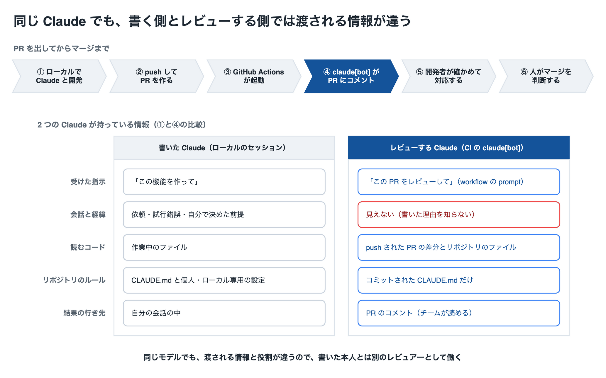

# Claude で書いたコードを、なぜ Claude にレビューさせるのか

> 出典（一次情報。引用はすべて 2026-11-09 に原文と照合した）:
> - [Best practices for Claude Code](https://code.claude.com/docs/en/best-practices) — 書いた本人ではないレビュアー、決定論的なチェックとの役割分担、「指摘を全部直さない」
> - [Security guidance plugin](https://code.claude.com/docs/en/security-guidance) — 書いた Claude に自己採点させない設計
> - [Code Review](https://code.claude.com/docs/en/code-review) — レビューは approve も block もしない、指摘ゼロはバグが無い証明ではない
> - [Claude Code GitHub Actions](https://code.claude.com/docs/en/github-actions) — CI で Claude を動かす仕組み、CI でも `CLAUDE.md` を読むこと
> - [Platforms and integrations](https://code.claude.com/docs/en/platforms) — Code Review の用途「Catching bugs before human review」
> - [Prompting Claude Opus 5](https://platform.claude.com/docs/en/build-with-claude/prompt-engineering/prompting-claude-opus-5) — 自分の作業の再確認と、独立したレビューの違い
> - [Harness design for long-running application development](https://www.anthropic.com/engineering/harness-design-long-running-apps)（Anthropic Engineering）— 自己評価の甘さと、作る側・評価する側の分離
> - [How Anthropic secures its AI-native software development lifecycle](https://claude.com/blog/how-anthropic-secures-its-ai-native-software-development-lifecycle)（2026-07-21）— Anthropic 社内の PR レビューの構成
> - [LLM Evaluators Recognize and Favor Their Own Generations](https://arxiv.org/abs/2404.13076)（Panickssery ほか, NeurIPS 2024）— LLM が自分の出力を高く評価する傾向
>
> 最終更新: 2026-11-09

ローカルの Claude Code で開発したコードを、Pull Request（PR）の段階で GitHub Actions の `claude[bot]` にもう一度レビューさせる。この運用に対して出やすい「同じ Claude が書いたものを同じ Claude が見て意味があるのか」という疑問に、公式ドキュメントと実例で答える。設定手順は [github-actions-claude-code-review.md](github-actions-claude-code-review.md) を参照する。

---

## 0. 要点

- **同じモデルでも、別のレビュアーになる。** CI の Claude は、書いたときの会話も、書いた理由も知らない。PR の差分とリポジトリのファイルを読み、「この PR をレビューして」という指示を受ける。公式も、レビューは書いた本人ではない Claude に任せるよう勧めている。
- **書いた本人は、自分の作業を甘く見る。** 人も AI も同じである。Anthropic は、エージェントに自分の成果物を評価させると、出来が明らかに平凡でも自信を持って褒めがちだと書いている。
- **CI に置くと、人が忘れても走り、結果が PR に残る。** ローカルのレビューは忘れることがあり、結果は本人の画面にしか残らない。CI のレビューは PR を作ったときと push のたびに自動で動き、指摘とその対応をチームの全員が後から読める。
- **人のレビューとテストの代わりにはならない。** BOT は approve も block もしない。指摘ゼロはバグが無いことの証明ではない。最終判断は人がする。

---

## 1. 前提: PR・CI・レビュー BOT

| 用語 | 意味 |
|---|---|
| Pull Request（PR） | ブランチの変更を main に取り込んでほしい、という GitHub 上の依頼。差分・コメント・チェック結果が 1 か所にまとまる |
| CI（Continuous Integration） | push や PR をきっかけに、決まった処理（テスト・lint・レビューなど）を自動で走らせる仕組み |
| GitHub Actions | GitHub の CI。リポジトリの `.github/workflows/*.yml` に、いつ何を走らせるかを書く |
| レビュー BOT（`claude[bot]`） | GitHub Actions の中で Claude Code を動かし、PR をレビューさせたもの。結果を PR のコメントとして投稿する。本リポジトリの workflow と各設定の意図は [github-actions-claude-code-review.md §2](github-actions-claude-code-review.md#2-正本-workflowコピペ用全文) にある |

流れは次の図の上段のとおりである。下段は、①で書いた Claude と④でレビューする Claude が、それぞれ何を持っているかを比べている。

---

## 2. 「同じ Claude」でも同じではない

モデルが同じでも、Claude の振る舞いは **渡された情報と指示** で決まる。書く側とレビューする側では、そのどちらも違う。

| 観点 | 書いた Claude（ローカル） | レビューする Claude（CI） |
|---|---|---|
| 受けた指示 | 「この機能を作って」 | 「この PR をレビューして」。観点は workflow の `prompt` に書く |
| 会話と経緯 | 依頼・試行錯誤・自分で決めた前提をすべて持っている | 持っていない。書いた理由を知らない |
| 読むコード | 作業中のファイル | push された PR の差分と、チェックアウトしたリポジトリのファイル |
| リポジトリのルール | リポジトリの `CLAUDE.md` に加え、個人の `~/.claude/CLAUDE.md` や gitignore したローカル専用のファイル | コミットされた `CLAUDE.md` だけ。公式は「Claude reads it on every run」と書いている |
| 結果の行き先 | 自分の会話の中 | PR のコメント |

いちばん効くのは「会話と経緯」の行である。書いた Claude は、なぜその書き方にしたかを知っている。そのため、コードを読むときも「こういう意図だから正しい」と、自分の理由で補って読む。CI の Claude にはその補いが無い。将来このコードを初めて読む人と同じ立場で読む。

公式の [Best practices](https://code.claude.com/docs/en/best-practices#give-claude-a-check-to-run) は、作業の確かめ方の 1 つとして、書いた本人ではないレビュアーを挙げている。

> By someone who didn't write the code: in the terminal, `/code-review` reviews the diff in a fresh subagent that never saw your conversation. It isn't swayed by the reasoning that produced the code.

同じページの「やめてよいこと」の表には、こうある。

> Handing the same task to a subagent doesn't make the answer any better. A fresh reviewer does help, because it hasn't seen your reasoning, which is a different thing from delegating.

つまり、同じ仕事を別の Claude にやらせ直しても良くはならないが、**書いた理由を見ていないレビュアー** は役に立つ。CI のレビュー BOT は、この「見ていない」状態を仕組みとして作る。

---

## 3. なぜ別のコンテキストだと効くのか

### 3.1 書いた本人は、自分の作業を甘く見る

Anthropic は、長時間動くエージェントの設計を書いた記事で、自己評価の問題を次のように書いている（[Harness design for long-running application development](https://www.anthropic.com/engineering/harness-design-long-running-apps)）。

> When asked to evaluate work they've produced, agents tend to respond by confidently praising the work—even when, to a human observer, the quality is obviously mediocre.

デザインのような主観的な作業で特に強く出るが、テストで確かめられる作業でも判断を誤ることがある、とも書いている。対策として挙げているのが、作る側と評価する側の分離である（本リポジトリでの詳しい整理は [harness.md §3.2](harness.md#32-自己評価の甘さself-evaluation-bias)）。

> Separating the agent doing the work from the agent judging it proves to be a strong lever to address this issue.

研究でも同じ傾向が報告されている。Panickssery らは、LLM が自分の出力と他の出力を見分けられること、そして見分けられるほど自分の出力を高く評価する（self-preference）ことを示した（[arXiv 2404.13076](https://arxiv.org/abs/2404.13076)、NeurIPS 2024）。ただしこの研究の対象は文章の要約で、コードのレビューではない。「書いた本人に評価させると甘くなりうる」ことの裏付けとして読む。

### 3.2 公式の機能も「自分で自分を採点させない」作りになっている

Claude Code の security guidance plugin は、レビューを書いた Claude とは別の呼び出しで行う。理由はこう書かれている（[Security guidance plugin](https://code.claude.com/docs/en/security-guidance)）。

> The plugin does not ask the same Claude instance that wrote the code to grade itself. (...) the reviewer starts from the diff, has no investment in the original approach, and is instructed only to find problems.

### 3.3 「Claude はもう自分で確かめている」こととの違い

[Prompting Claude Opus 5](https://platform.claude.com/docs/en/build-with-claude/prompt-engineering/prompting-claude-opus-5) は、Opus 5 が指示しなくても自分の作業を確かめるため、「最後に確認して」「subagent に verify させて」という指示は消してよい、と書いている。

> Claude Opus 5 verifies its own work without being told to. If your prompt contains explicit verification instructions (...), remove them: instructions like these cause over-verification on Claude Opus 5 (...)

これは「書いた本人に、もう一度自分の作業を見直させる」指示の話である。書いた理由を知らない別のレビュアーとは別物で、[2 章](#2-同じ-claudeでも同じではない) で引いた Best practices の「A fresh reviewer does help」と矛盾しない。同じガイドは、レビューする側としての Opus 5 について次のように書いている。

> Claude Opus 5 reviews code with high precision and recall: it finds real bugs at a high rate per pass, and its additional findings are mostly real issues rather than false positives.

---

## 4. CI に置く意味 — ローカルの `/code-review` との違い

ローカルの `/code-review` も「書いた本人ではないレビュアー」である。それでも CI にレビューを置くのは、次の点が違うからである。

| 観点 | ローカルの `/code-review` | CI の `claude[bot]` |
|---|---|---|
| 走るかどうか | 開発者が実行したときだけ | PR を作ったとき・push したときに自動で走る |
| 結果が残る場所 | 開発者の会話の中 | PR のコメント。チームの誰でも、後からでも読める |
| レビューする対象 | 手元の作業ツリー（未 push の変更を含む） | push された PR の状態。マージされる内容そのもの |
| 観点の決め方 | 実行する人ごと | workflow の `prompt` に書き、リポジトリで揃える |
| 実行する環境 | 開発者のマシン | GitHub Actions の runner。手元の設定に左右されない |

レビュー手段ごとの起動・課金・設定の違いは [code-review.md §9](code-review.md#9-3-つのレビュー手段の比較) にまとめてある。

公式の [Best practices](https://code.claude.com/docs/en/best-practices#deterministic-and-non-deterministic-instructions) は、Claude が判断して行うこと（non-deterministic）と、仕組みが必ず実行すること（deterministic）を分けて整理している。「終わったかどうか」の行では、`/code-review` が前者、CI が後者に入っている。

> | | Non-deterministic (Claude decides) | Deterministic (Claude Code enforces) |
> | :- | :- | :- |
> | When it's done | A request for evidence, `/goal`, `/code-review` | Tests, typecheck, a `Stop` hook, CI |
> | Who has the last word | Claude's summary of what it did | Branch protection, a person who approves the merge |

レビューの中身は Claude の判断だが、**レビューを走らせること** は人の記憶に頼らず CI に任せられる。ただし実行が失敗しても（認証の期限切れなど）マージは止まらない。PR にレビューのコメントが付いたかは確かめる。

Anthropic 自身も、社内では PR を開くと複数のエージェントが自動でレビューする運用をしている。観点ごとに狭く分けた理由の 1 つとして、「They do not share biases and blindspots」を挙げている（[How Anthropic secures its AI-native software development lifecycle](https://claude.com/blog/how-anthropic-secures-its-ai-native-software-development-lifecycle)。整理は [harness.md §4.11](harness.md#411-evaluator-を複数の狭いレビュアーに分割する2026-07-21-公式)）。レビューを 1 回で終わらせず、別の目を何段も重ねる考え方である。

---

## 5. このリポジトリでの実例

本リポジトリでは、workflow を入れた 2026-05-25 以降の PR が `claude[bot]` のレビューを受けている。たとえば [#39](https://github.com/thanks2music/jarvis/pull/39) は、push の前にローカルで `/code-review` と仕様照合のレビューを通し、その指摘を直してから PR にした（`a8e3c8e`・`e5f379d`）。それでも CI のレビューは、ローカルで出なかった指摘を出した。

| PR | `claude[bot]` の指摘 | 対応 |
|---|---|---|
| [#39](https://github.com/thanks2music/jarvis/pull/39#issuecomment-6722683403) | 「Python 3.15.2」「uv 0.13.7」の版番号に、どこで取得したかの出典が無い | 採用。出典の URL を足した（`291b0cb`） |
| [#39](https://github.com/thanks2music/jarvis/pull/39#issuecomment-6722705751) | 図の生成スクリプトがリポジトリの外のライブラリに依存している。どのファイルが正本かを書くとよい | 採用。正本のファイルを明記した（`ba26807`） |
| [#41](https://github.com/thanks2music/jarvis/pull/41#issuecomment-6724573500) | 変わりやすい記述（ライブラリの保守状況）に、いつ時点の情報かを書くとよい | 採用。「2026-11-09 時点」を足した（`60322c3`） |
| [#41](https://github.com/thanks2music/jarvis/pull/41#issuecomment-6724593113) | 「最終更新」の日付が未来になっている | 不採用。作業は日本時間で 11-09、レビューの環境は UTC で 11-08 だった。理由を返信した |

CI の Claude は会話を持たないので、「日本時間で作業した」という前提も知らない。前提を知らないことは、思い込みの無いレビューの源であると同時に、的外れな指摘の源にもなる。だから指摘は鵜呑みにせず、確かめてから直すか、理由を添えて返信する（[6 章](#6-限界と使い方)）。

---

## 6. 限界と使い方

**同じモデルは、同じ盲点を持ちうる。** 会話を切り離しても、モデルの知識の古さや得意・不得意は変わらない。harness design の記事も、評価する側を分けても「the evaluator is still an LLM that is inclined to be generous towards LLM-generated outputs」と書いている。テスト・型チェック・lint のような、Claude の判断に頼らないチェックを併用する。

**指摘ゼロは、問題が無いことの証明ではない。** 公式の [Code Review](https://code.claude.com/docs/en/code-review) はこう注記している。

> A review with no findings doesn't mean your code is error-free or secure.

**BOT はマージを決めない。** 同じページに「A review never approves or blocks the pull request, so the decision to merge stays with your team.」とある。Anthropic の社内運用の記事も「Human accountability is still central for code that is reviewed and merged by Claude.」と書いている。

**指摘を全部直さない。** [Best practices](https://code.claude.com/docs/en/best-practices#review-against-your-spec) は、問題を探すよう頼まれたレビュアーについてこう書いている。

> A reviewer that's asked to find problems will always find *something*. If you fix every finding, you end up with extra abstraction layers and tests for cases that can't happen.

指摘ごとに、コードと一次情報で正しいかを確かめる。正しいものだけ直し、前提の誤りや過剰な指摘には理由を返信して残す。

**コストがかかる。** CI のレビューも Claude の利用量や API の料金を使う。push のたびに走るので、古い実行を取り消す設定（本リポジトリは `concurrency`。[§2](github-actions-claude-code-review.md#2-正本-workflowコピペ用全文)）を入れておく。

---

## 7. よくある疑問

**Q. ローカルで `/code-review` を通しているなら、CI は要らないのでは？**
A. 走るかどうか・結果が残る場所・レビューする対象が違う（[4 章](#4-ci-に置く意味--ローカルの-code-review-との違い)）。両方を使うと、ローカルで大きな問題を先に潰し、CI で取りこぼしを拾う、という 2 段になる。

**Q. 同じモデルなら、同じ間違いを見逃すのでは？**
A. その可能性はある。ただ、書いた理由で補って読むことによる見逃しは、コンテキストを切り離せば外せる（[2 章](#2-同じ-claudeでも同じではない)）。モデル自体の盲点は、テストや lint、人のレビューで補う（[6 章](#6-限界と使い方)）。

**Q. AI がレビューするなら、人のレビューは要らなくなる？**
A. ならない（[6 章](#6-限界と使い方)）。AI のレビューは、人がレビューする前に機械的に拾える問題を拾っておく段階と考える。公式の [Platforms](https://code.claude.com/docs/en/platforms) も、Code Review の用途を「Catching bugs before human review」と書いている。

**Q. コストに見合う？**
A. 見合うかはチームとリポジトリによる。判断の材料として、指摘のうち実際に直したものの数を PR で数えるとよい（[5 章](#5-このリポジトリでの実例) の表がその例）。

---

## 関連ドキュメント

- [GitHub Actions で Claude Code レビュー BOT を設定する](github-actions-claude-code-review.md) — 本リポジトリの workflow の全文と設定手順
- [マネージド Code Review](code-review.md) — Team / Enterprise 向けのマネージド版と、3 つのレビュー手段の比較（§9）
- [ハーネス設計ガイド](harness.md) — 自己評価の甘さ（§3.2）と、観点を絞った複数のレビュアー（§4.11）
- [ClaudeCode のベストプラクティス](best-practices.md) — Writer / Reviewer パターン
